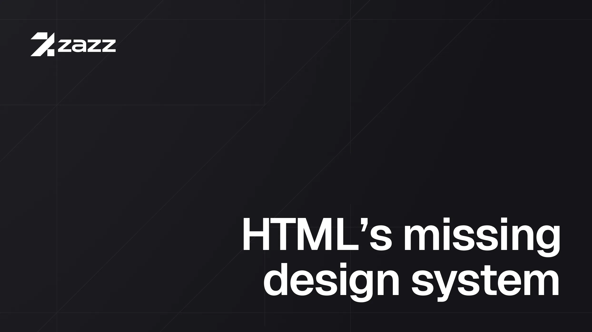

# Zazz

> [!WARNING]
> Author's note: Zazz is still in an early alpha stage. While it is publicly available I hesitate to call it "beta" since much of the syntax and DX tools are in flux. That said, Zazz UI is being adopted by projects right now and is in a usable state. I welcome any and all feedback and plan to open Zazz up to contributions down the road. Be sure to check the changelogs for breaking changes even between minor version bumps.

## Roadmap to 1.0.0

For Zazz UI to hit 1.0.0 and be considered stable, `if()` css conditionals must become widely adopted by browsers. We are getting close! This will _significantly_ simplify much of the implementation that currently relies on `@property` types for the style utilities. `if()` and `@functions` will reduce the number of tradeoffs between features and file size and likely improve performance.

> [!NOTE]
> Author's note: I want to be transparent upfront about the use of LLMs in this project. While the concept of Zazz and the initial implementation were all developed by hand, LLMs have proven to be invaluable in two specific ways:
>
> First, the docs are 99% LLM generated. This is not the long-term goal. Personally, I prefer a human touch for written content as I have come to appreciate the unique and personal voice of individuals in contrast to the uncanny valley of LLM writing. That said, this is a one-man project at the moment and LLMs have taken the burden of keeping the docs current until I (or someone else) can rework them.
>
> Second, most of the code used to test and output the Zazz UI builds are generated from the concepts and code I originally developed by hand. I mention this to (hopefully) assure you that I actually know how Zazz works.
>
> As they say on X/Twitter, "Trust me bro."
>
> — Derek

## Introduction

Monorepo for the Zazz Design Framework: a UI kit for plain HTML, built on modern web standards. Markup carries every styling decision as an identity (`data-ui="button"`), a preset (`data-button-variant="primary"`), or a style utility (`style="--px: 6"`); design tokens, cascade layers, and a few light-DOM custom elements sit underneath. No build step, no class names.

**Status: 0.8 alpha.** The markup contract can change in any minor release before 1.0, and 0.5 and later are not compatible with 0.4. Breaking changes are flagged in [`packages/core/CHANGELOG.md`](packages/core/CHANGELOG.md) with migration notes.

Docs: [zazz.sh](https://zazz.sh). Quick start: [zazz.sh/docs/quick-start](https://zazz.sh/docs/quick-start/).

[](https://zazz.sh)

## Quick start

```bash
npx zazz-ui init            # vendors the base into ./zazz and writes zazz/head.html
npx zazz-ui add button card # adds primitives and their dependencies
```

Paste `zazz/head.html` into your `<head>`, then write markup:

```html
<div data-ui="card" data-card-variant="outline" style="--p: 6">
  <button data-ui="button" data-button-variant="primary">Save</button>
</div>
```

To try it without installing anything, the [quick start](https://zazz.sh/docs/quick-start/) loads the kit from a CDN, and the [playground](https://zazz.sh/playground/) runs in the browser.

## Agent skills

Two skills teach coding agents (Claude Code, Cursor, Codex, and others) to work with Zazz:

```bash
npx skills add dereknelsen/zazz-ui                                    # both
npx skills add dereknelsen/zazz-ui --skill zazz                       # the design system
npx skills add dereknelsen/zazz-ui --skill install-zazz-in-legacy-app # adding Zazz to an older app
```

- [`zazz`](skills/zazz/): install and update routes, the VS Code extension, the markup model, design guidance, and where to look things up on zazz.sh.
- [`install-zazz-in-legacy-app`](skills/install-zazz-in-legacy-app/): an interview that settles the install plan one round of decisions at a time, then a procedure that keeps the old pages looking the same with Zazz loaded.

## Layout

| Path                       | What it is                                                                                                                                                                                      |
| -------------------------- | ----------------------------------------------------------------------------------------------------------------------------------------------------------------------------------------------- |
| `packages/core`            | [`@zazz-ui/core`](packages/core): the kit. Primitives co-located under `src/primitives/<name>/` (css + ts + example html), base layers and runtime under `src/base/`, editor data in `editor/`. |
| `packages/cli`             | [`zazz-ui`](packages/cli): vendors the kit into a project (`init`, `add`, `update`, `diff`) with provenance, so updates merge instead of overwrite.                                             |
| `packages/language-server` | `@zazz-ui/language-server` (private): LSP for Zazz in HTML; the `<ui-debug>` audit, completions, hover, formatting.                                                                             |
| `packages/eslint-plugin`   | `@zazz-ui/eslint-plugin` (private): the same audit as html-eslint rules; `vp run lint:html`.                                                                                                    |
| `packages/vscode`          | `zazz-vscode` (private): the VS Code extension, a client over the server plus grammar, snippets, Emmet, templates. `vp run zazz-vscode#package` builds the `.vsix`.                             |
| `apps/docs`                | The documentation site (Astro + Markdoc + Pagefind, styled with Zazz). Its API reference is generated from the kit's data at build time.                                                        |
| `apps/experiments`         | A Vite app for authoring UI against the kit's sources with hot reload and `<ui-debug>`.                                                                                                         |

Vocabulary is in [`CONTEXT.md`](CONTEXT.md), the markup contract in [`SPEC.md`](SPEC.md), decisions in [`docs/adr/`](docs/adr/), and the markup rules in [`packages/core/AUTHORING.md`](packages/core/AUTHORING.md).

## Development

Tooling is [Vite+](https://viteplus.dev) (`vp`): one CLI for install, format, lint, type check, test, and tasks.

```bash
vp install

pnpm dev                 # build core, then the docs site at localhost:4321
vp run playground        # the authoring playground
vp run core#dev          # tsc --watch for kit scripts

vp check && vp run -r test   # format, lint, type check, test each package
vp run ready             # the whole-repo gate: check, lint html, build, test
```

The docs site needs the kit built once (`vp run core#build`) so `packages/core/dist` exists; `vp run docs#build` then writes a static site, and `vp run docs#links` checks it for broken internal links.

## Publishing

`@zazz-ui/core` and `zazz-ui` publish to npm on independent version lines ([ADR-0010](docs/adr/0010-kit-first-independent-versioning.md)). Releases are manual; the checklist is the `zazz-version-bump` skill under `.claude/skills/`. Versions are immutable: a bad release gets `npm deprecate` plus a patch, never an unpublish.

## Contributing

Bug reports and discussions are welcome. Pull requests aren't, for now; [CONTRIBUTING.md](.github/CONTRIBUTING.md) explains why.

## License

MIT. Copyright © 2026 Derek Nelsen
